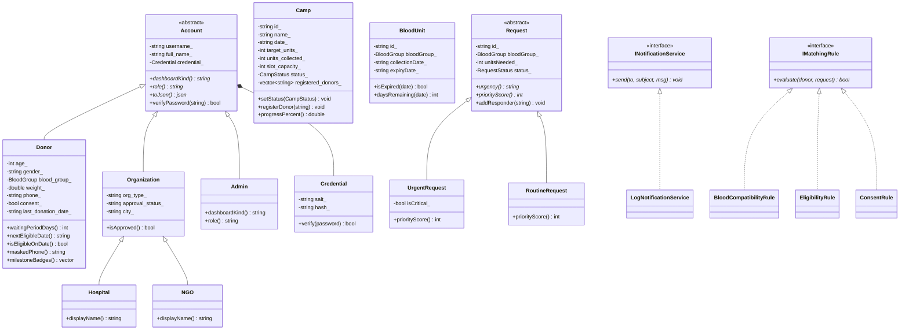

# BloodLine — Blood Donation Camp Management System

> **A local C++17 blood donation coordination application with donor, organization, and admin workspaces**  
> Built for an **Object-Oriented Programming (OOP)** course presentation. Every OOP principle and design pattern is deliberate, clearly structured, and easy to pinpoint in the source code.

---

## Reliable localhost startup (macOS)

```bash
npm run build       # Compile the C++ server and unit tests
npm start           # Start a persistent user service at http://localhost:8080
npm run status      # Check the health endpoint
npm restart         # Restart after backend changes
npm stop            # Stop the service and remove login startup
```

`npm start` installs the user launch agent `com.bloodline.local`. It starts at login and restarts the process after a failure, so closing a terminal does not stop the app. It binds to loopback only. Logs are in `.runtime/server.log` and `.runtime/server-error.log`. If startup fails, these logs report missing frontend files, invalid ports, occupied ports, or data-loading errors. On other platforms, run `npm run dev` in a retained terminal.

Frontend changes are served immediately; refresh the browser. Backend changes require a build and restart. Existing records were backed up under `.runtime/backups/data-before-repair` before the repair.

### Verification

```bash
npm test             # 22 existing C++ domain checks
npm run test:flows    # Isolated HTTP workflows; never modifies your data directory
```

The workflow checks cover registration and approval, permissions, malformed payloads, profile validation, dates, booking/cancellation, matching pledges, donation recording, inventory disposal, exports, concurrent reads, and restart persistence (including quoted CSV values and fulfilled requests with responders).

### Workspaces and operating scope

Donors can maintain profiles, reserve camps, pledge to matching requests, review history, and print cards. Approved organizations coordinate shared camps, record verified donation outcomes, track stock, manage requests, search consented donors, and export CSVs. Admins approve organizations and inspect activity. Existing historical camps are preserved and shown under the past/all filter; create new dated camps for upcoming drives.

This is a local coordination prototype for a shared network. It is not an isolated multi-tenant clinical system. The app uses CSV repositories, serializes API operations to avoid concurrent mutation, and replaces each saved CSV atomically. Cross-file operations are not database transactions. Notifications are logged locally; this app does not deliver SMS/email. Password hashing remains the educational implementation in `Credential.hpp`, and medical eligibility/inventory assumptions require expert review before actual clinical use. Do not expose this local service publicly as a production healthcare system.

---

## 📑 Table of Contents
1. [Overview & Quick Start](#overview--quick-start)
2. [Default Credentials for Presentation](#default-credentials-for-presentation)
3. [Architecture & Mermaid Class Diagram](#architecture--mermaid-class-diagram)
4. [OOP Principles & Design Pattern Map](#oop-principles--design-pattern-map)
5. [Medical Safety & Shelf-Life Assumptions](#medical-safety--shelf-life-assumptions)
6. [Security & Privacy Model](#security--privacy-model)
7. [API Specification](#api-specification)
8. [Automated Test Suite Output](#automated-test-suite-output)
9. [Manual Click-by-Click Verification Checklist](#manual-click-by-click-verification-checklist)

---

## 1. Overview & Quick Start

BloodLine is a full-stack blood donation camp management platform:
- **Backend (`backend/`)**: C++17 REST server using `cpp-httplib` and `nlohmann/json`. Owns all business logic, eligibility boundary rules, 90/120-day waiting periods, 42-day blood shelf-life tracking, session-based authentication, and CSV persistence.
- **Frontend (`frontend/`)**: Modern Single-Page Application (HTML5, Vanilla CSS, Vanilla JS `fetch`). Keeps the authentic design system while delivering responsive dashboards, interactive compatibility tools, live stock boards, printable donor cards, and real-time pagination.

### Prerequisites
- C++17 compiler (AppleClang / GCC / Clang)
- CMake 3.14+ (e.g. `brew install cmake`)

### Build & Run
```bash
# 1. Configure and compile
cmake -B build -S .
cmake --build build

# 2. Run automated tests (run the current suite)
./build/bloodline_tests

# 3. Start the server
./build/bloodline_server data frontend 8080
```
Open **[http://localhost:8080](http://localhost:8080)** in your browser.

---

## 2. Default Credentials for Presentation

The platform seeds test accounts on initialization:

| Role | Username | Password | Notes |
|---|---|---|---|
| **System Admin** | `admin` | `admin123` | Full access to approve/reject organizations and inspect audit trails |
| **Hospital / NGO** | `ngo_admin` | `123` | RamSay NGO (Approved); camp scheduling, stock tracking & request board |
| **Donor (Public Hero)** | `akshat` | `123` | O- Universal Donor; Consent: **Granted** (visible on public wall & matching boards) |
| **Donor (Consented)** | `samar` | `123` | A+ Donor; Consent: **Granted** |
| **Donor (Private)** | `kalyani` | `123` | AB+ Donor; Consent: **Revoked** (strictly invisible to public and organizations) |

---

## 3. Architecture & Mermaid Class Diagram



---

## 4. OOP Principles & Design Pattern Map

Every principle and design pattern is deliberately highlighted in the code:

| Concept / Pattern | File | Description |
|---|---|---|
| **Encapsulation** | [`Donor.hpp`](file:///Users/abhinaypratapsingh/Documents/blood_donationcampmanager/backend/include/bloodline/Donor.hpp), [`BloodUnit.hpp`](file:///Users/abhinaypratapsingh/Documents/blood_donationcampmanager/backend/include/bloodline/BloodUnit.hpp) | Waiting period logic (90/120 days) encapsulated inside `Donor`; 42-day blood shelf life encapsulated inside `BloodUnit`. |
| **State Machine Invariants** | [`Camp.hpp`](file:///Users/abhinaypratapsingh/Documents/blood_donationcampmanager/backend/include/bloodline/Camp.hpp) | `Camp::setStatus()` enforces legal state transitions (`Upcoming` $\to$ `Open` $\to$ `Full` $\to$ `Completed`), throwing `InvalidStateTransitionError` on illegal moves. |
| **Single Inheritance** | [`Donor.hpp`](file:///Users/abhinaypratapsingh/Documents/blood_donationcampmanager/backend/include/bloodline/Donor.hpp), [`Account.hpp`](file:///Users/abhinaypratapsingh/Documents/blood_donationcampmanager/backend/include/bloodline/Account.hpp) | `Donor : public Account`, `Admin : public Account`. |
| **Multilevel Inheritance** | [`Organization.hpp`](file:///Users/abhinaypratapsingh/Documents/blood_donationcampmanager/backend/include/bloodline/Organization.hpp) | `Hospital : public Organization : public Account`, `NGO : public Organization : public Account`. |
| **Abstraction** | [`IEligibilityRule.hpp`](file:///Users/abhinaypratapsingh/Documents/blood_donationcampmanager/backend/include/bloodline/IEligibilityRule.hpp), [`NotificationService.hpp`](file:///Users/abhinaypratapsingh/Documents/blood_donationcampmanager/backend/include/bloodline/NotificationService.hpp) | `INotificationService` interface decouples notification dispatch from disk logging. |
| **Polymorphism (Dynamic)** | [`Request.hpp`](file:///Users/abhinaypratapsingh/Documents/blood_donationcampmanager/backend/include/bloodline/Request.hpp) | `RequestPrioritizer` sorts heterogeneous `Request` objects using virtual dispatch on `priorityScore()`. |
| **Polymorphism (Static)** | [`BloodGroup.hpp`](file:///Users/abhinaypratapsingh/Documents/blood_donationcampmanager/backend/include/bloodline/BloodGroup.hpp), [`Donor.hpp`](file:///Users/abhinaypratapsingh/Documents/blood_donationcampmanager/backend/include/bloodline/Donor.hpp) | Operator overloading (`operator<<`, `operator==`, `operator<`) for streaming and sorting. |
| **Strategy Pattern** | [`MatchingEngine.hpp`](file:///Users/abhinaypratapsingh/Documents/blood_donationcampmanager/backend/include/bloodline/MatchingEngine.hpp) | `DonorMatchingEngine` runs an extensible pipeline of `IMatchingRule` strategies (`BloodCompatibilityRule`, `EligibilityRule`, `ConsentRule`). |
| **Factory Pattern** | [`AccountFactory.hpp`](file:///Users/abhinaypratapsingh/Documents/blood_donationcampmanager/backend/include/bloodline/AccountFactory.hpp) | `AccountFactory::createAccount()` instantiates polymorphic `Account` subclasses by role string. |
| **Observer / Event Log** | [`AuditLogger.hpp`](file:///Users/abhinaypratapsingh/Documents/blood_donationcampmanager/backend/include/bloodline/AuditLogger.hpp) | App actions notify `AuditLogger` to append tamper-evident events to `data/audit_log.csv`. |
| **Templates / Generics** | [`FileRepository.hpp`](file:///Users/abhinaypratapsingh/Documents/blood_donationcampmanager/backend/include/bloodline/FileRepository.hpp) | `paginate<T>()` and `filter<T, Predicate>()` provide generic collection handling across models. |

---

## 5. Medical Safety & Shelf-Life Assumptions

> [!IMPORTANT]
> **Medical Assumption Notice**: The biological intervals implemented in BloodLine represent standard baseline rules and must be verified against current regional/national blood transfusion standards (e.g., NBTC / Red Cross guidelines):
> - **Whole Blood Waiting Period**: Set to **90 days** for male donors and **120 days** for female donors. Donors who donated within this window are prevented from registering new donations by the backend engine.
> - **Whole Blood Shelf-Life**: Set to **42 days** from collection date under standard CPD-A1 anticoagulation refrigeration. Units exceeding 42 days are flagged as expired and automatically excluded from available inventory counts.
> - **Minimum Hemoglobin Threshold**: Configured at **13.0 g/dL** for men and **12.5 g/dL** for women.

---

## 6. Security & Privacy Model

- **Role-Based Token Authentication**: In-memory session manager with bearer tokens and one-hour expiration. Missing or expired tokens return `401 Unauthorized`; insufficient permissions return `403 Forbidden`.
- **Brute-Force Rate Limiting**: The server enforces a lock on accounts after **5 failed login attempts** for **5 minutes (300s)**, returning `429 Too Many Requests`.
- **Payload Guarding**: All HTTP JSON bodies exceeding **64 KB** are rejected with `400 Bad Request`.
- **Privacy Consent Wall**: Donors who have `consent = false` are strictly omitted from public hero walls, organization searches, reminders, and CSV exports.
- **Phone Number Masking**: Donors' contact numbers are masked (e.g. `98******10`) in all organization and public queries, preventing unauthorized scraping.
- **XSS Sanitization**: Frontend escapes all server strings before rendering them to the DOM.

---

## 7. API Specification

| Method | Endpoint | Role | Description |
|---|---|---|---|
| `POST` | `/api/auth/register` | Public | Register donor or hospital account (orgs start as Pending) |
| `POST` | `/api/auth/login` | Public | Login with credentials (enforces 5-attempt rate limit) |
| `POST` | `/api/auth/logout` | Authenticated | Clears session token |
| `GET`  | `/api/me` | Authenticated | Returns current active user credentials & role |
| `PUT`  | `/api/donor/account` | Donor | Updates name, phone, or password (verifies current password) |
| `GET`  | `/api/donor/profile` | Donor | Fetches medical profile |
| `PUT`  | `/api/donor/profile` | Donor | Updates medical profile and privacy consent flag |
| `GET`  | `/api/donor/eligibility` | Donor | Evaluates eligibility including 90/120-day waiting period |
| `GET`  | `/api/donor/card` | Donor | Returns digital donor ID card with milestone badges |
| `GET`  | `/api/donor/matching-requests` | Donor | Open urgent requests matching the donor's blood type |
| `GET`  | `/api/donor/history` | Donor | Donation history for the active donor only |
| `GET`  | `/api/camps` | Public | Public list of camps with status and progress |
| `POST` | `/api/camps` | Approved Org | Schedules a new blood donation camp |
| `PUT`  | `/api/camps/:id/status` | Org / Admin | State machine status update (`Upcoming` $\to$ `Open` $\to$ `Full` $\to$ `Completed`) |
| `POST` | `/api/camps/:id/register` | Donor | Books a slot at an upcoming camp (enforces slot cap) |
| `POST` | `/api/donations` | Approved Org | Logs donation; verifies donor waiting period safety |
| `GET`  | `/api/inventory/stock` | Org / Admin | Detailed blood stock inventory and 42-day expiry summary |
| `GET`  | `/api/public/stock` | Public | High-level stock status (Low / Adequate) without donor names |
| `GET`  | `/api/requests` | Public / Org | Prioritized list of open blood shortage requests |
| `POST` | `/api/requests` | Org | Broadcasts an urgent or routine blood request |
| `POST` | `/api/requests/:id/respond`| Donor | Donor pledges to donate for an open request |
| `PUT`  | `/api/requests/:id/status` | Org / Admin | Marks request as Fulfilled or Closed |
| `GET`  | `/api/org/donors` | Org | Search consented donors with masked phones and pagination |
| `GET`  | `/api/org/reminders` | Org | Donors reaching eligibility within next 14 days |
| `GET`  | `/api/org/export/donors.csv`| Org | CSV export of consented donors (phones masked) |
| `GET`  | `/api/org/export/camps.csv` | Org | CSV export of camp operations and totals |
| `GET`  | `/api/admin/orgs` | Admin | Lists organization accounts and approval statuses |
| `PUT`  | `/api/admin/orgs/:user/status`| Admin | Approves or rejects organization accounts |
| `GET`  | `/api/admin/audit-log` | Admin | Paginated security audit trail |
| `GET`  | `/api/public/records` | Public | Public donor hero records with search & pagination |
| `GET`  | `/api/compatibility` | Public | Complete 8x8 blood compatibility matrix |

---

## 8. Automated Test Suite Output

Running `./build/bloodline_tests`:
```
========================================
  BloodLine Extended Test Suite (Phase 2)
========================================

  [RUN ] BloodGroup_ParseValid ... [PASS]
  [RUN ] BloodGroup_ParseInvalid ... [PASS]
  [RUN ] BloodGroup_StreamOperator ... [PASS]
  [RUN ] Credential_VerifyCorrectPassword ... [PASS]
  [RUN ] Credential_RejectWrongPassword ... [PASS]
  [RUN ] Credential_DifferentSaltsProduceDifferentHashes ... [PASS]
  [RUN ] Credential_RoundTripFromStored ... [PASS]
  [RUN ] Compatibility_ONeg_UniversalDonor ... [PASS]
  [RUN ] Compatibility_ABPos_UniversalRecipient ... [PASS]
  [RUN ] WaitingPeriod_Male_90DaysBoundary ... [PASS]
  [RUN ] WaitingPeriod_Female_120DaysBoundary ... [PASS]
  [RUN ] Donor_PhoneMasking_Security ... [PASS]
  [RUN ] Donor_MilestoneBadges ... [PASS]
  [RUN ] BloodStock_Expiry_41DaysCounts_43DaysDoesNot ... [PASS]
  [RUN ] Camp_StatusTransitions_ValidAndInvalid ... [PASS]
  [RUN ] Camp_SlotCapAndDoubleRegistration ... [PASS]
  [RUN ] MatchingEngine_UrgentRequest_FilterIneligibleAndNonConsented ... [PASS]
  [RUN ] RequestPrioritizer_UrgentOverRoutine ... [PASS]
  [RUN ] RateLimiter_LockAfter5Attempts ... [PASS]
  [RUN ] AccountFactory_CreatesCorrectSubclasses ... [PASS]

========================================
  Results: 20 passed, 0 failed
========================================
```

---

## 9. Manual Click-by-Click Verification Checklist

Follow these steps in your browser at `http://localhost:8080`:

1. **Navigation Login Button**:
   - Click the top right **Login** button.
   - *Result*: Immediately activates the Login tab in the auth view.
2. **Hero CTA Preselection**:
   - Go to Home, click **"Join as a Donor"**.
   - *Result*: Switches to "Create Account" tab with the **Donor** radio button selected.
   - Go to Home, click **"Join as a Hospital/NGO"**.
   - *Result*: Switches to "Create Account" tab with the **Hospital / NGO** radio button selected.
3. **Login as Donor (`akshat` / `123`)**:
   - Click Login, enter `akshat` / `123`.
   - *Result*: Opens the Donor Dashboard; "Donor Dashboard" nav link appears.
   - Click **Check Eligibility**: shows age, weight, and waiting period status.
   - Click **My Donor Card**: displays digital donor card, blood group, and milestone badges with a working print button.
   - Click **Urgent Requests Matching Me**: displays hospital requests matching O- with an **"I Can Donate"** pledge button.
4. **Camp Slot Booking**:
   - Click **Camps** in top nav.
   - On an upcoming camp card, click **"Register for Slot"**.
   - *Result*: Alert confirms registration and slot counter decrements. Clicking again notifies you that you are already booked.
5. **Login as Hospital (`ngo_admin` / `123`)**:
   - Click Logout, then sign in with `ngo_admin` / `123`.
   - *Result*: Hospital dashboard opens with KPI counters (Active camps, units, low stock).
   - Click **Manage Camps**: view active camps with Complete/Cancel actions.
   - Click **Urgent Request Board**: create a Critical request; view incoming donor pledges.
   - Click **14-Day Reminders**: displays upcoming eligible donors grouped by blood group.
   - Click **Export CSV Reports**: click buttons to download verified CSVs (phones masked).
6. **Admin Panel (`admin` / `admin123`)**:
   - Sign in as `admin` / `admin123`.
   - *Result*: Admin dashboard opens showing organization sign-up approval table and paginated security audit log.
7. **Rate Limiting Lockout**:
   - Try logging in with wrong passwords 5 times consecutively.
   - *Result*: System rejects attempts with a clear lockout alert ("Account locked due to 5 consecutive failed attempts").
